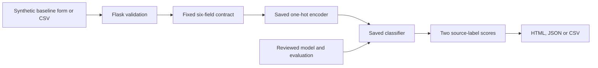
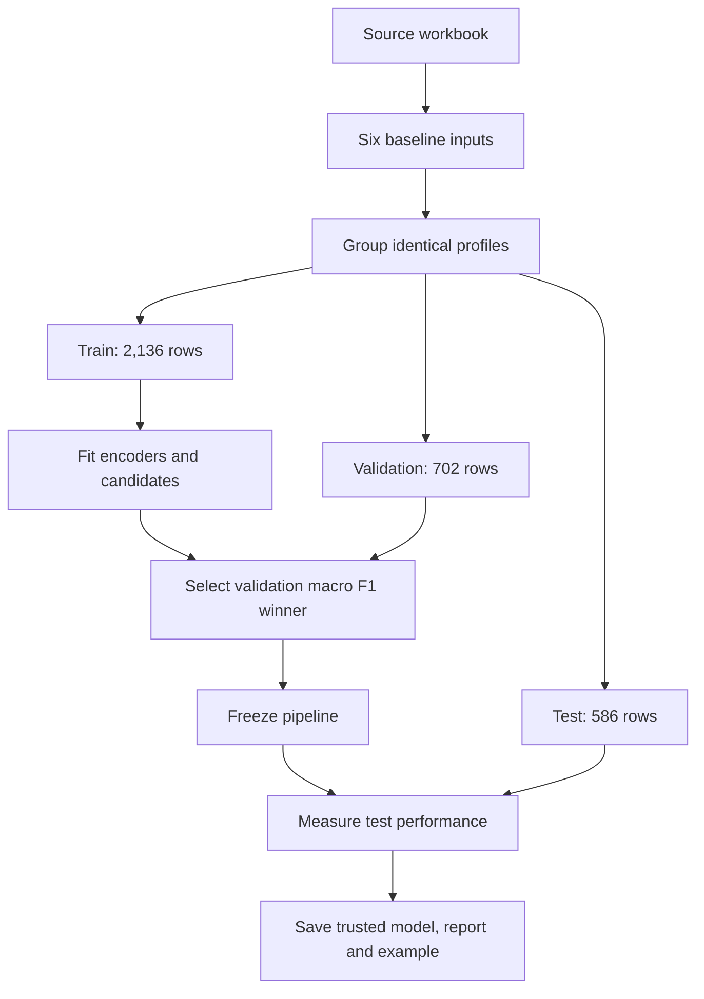
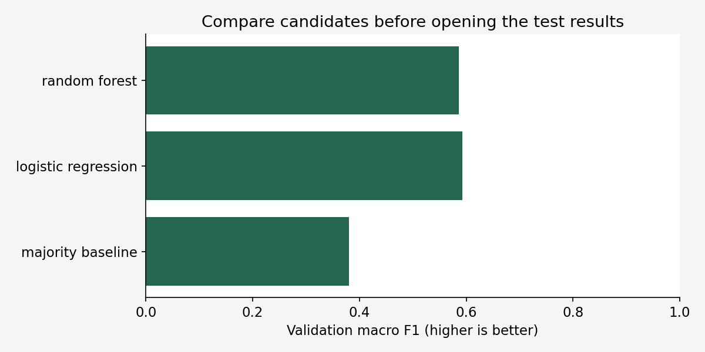
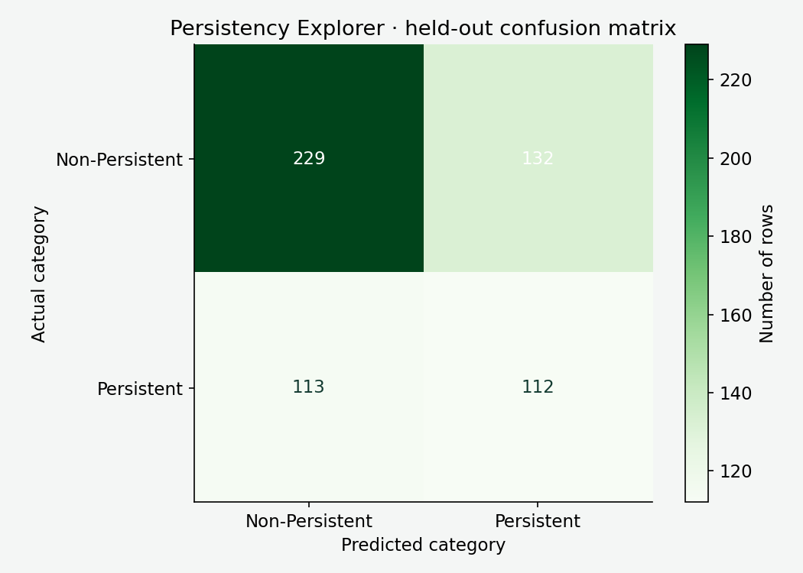
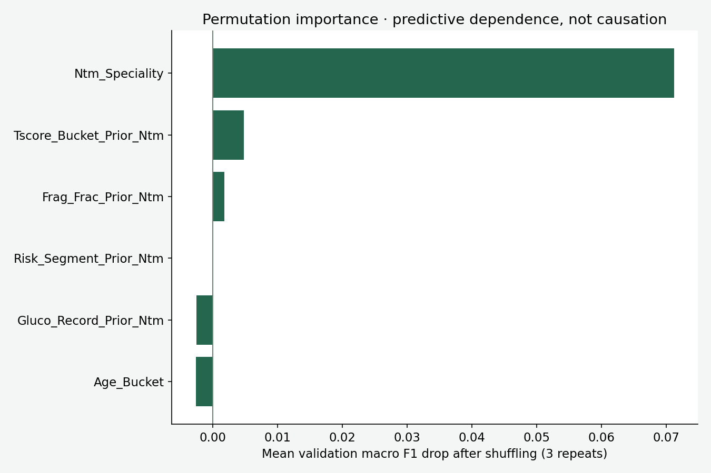
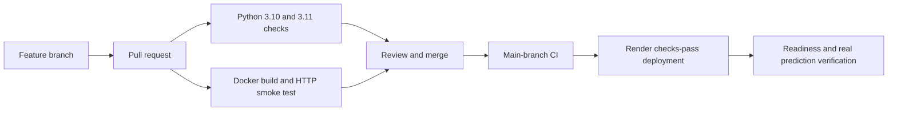

# Persistency Explorer

A **baseline-only patient persistency learning application**: Flask interface, JSON API, batch CSV scoring, reproducible model comparison, Docker and CI/CD.

The important result is not a high accuracy claim: **the six baseline inputs provide limited predictive power in this retrospective dataset**. The selected model is useful for demonstrating an honest ML workflow and its limitations. It is not suitable for patient-level clinical decisions.

> Use synthetic examples only. Do not upload patient records. Source follow-up duration, collection dates and detailed outcome definition are undocumented. Scores are not calibrated clinical probabilities, treatment recommendations or evidence that one treatment causes better persistence.

## Problem and intended use

Persistency generally concerns remaining on a treatment over a defined period. This dataset contains two source labels, `Persistent` and `Non-Persistent`. Without documented follow-up duration, we cannot translate those labels into a probability of continuing a particular treatment for a particular time.

The user can select a hypothetical baseline profile, compare both class scores, download a synthetic example, score a CSV and inspect measured evaluation. A developer can reproduce training and understand why an apparently powerful notebook can be misleading when it includes information observed after prediction time.

## What changed from the original notebook

The original notebook, saved model, workbooks, PDF and processed files remain available. [The original README](archive/original_README.md) is preserved. The application does **not** load the old `.sav` model or silently reproduce its evaluation.

The notebook uses during-treatment measurements and `Adherent_Flag`. Those may be unavailable at baseline or closely related to the outcome. The redesigned app deliberately excludes them. Categorical dictionaries are shared between the app and training; one-hot encoding is fitted on training only. Identical selected baseline profiles remain in one partition.

This changes the prediction task and can lower performance. Reporting the lower result is preferable to presenting potentially outcome-informed performance as a prospective baseline prediction.

## Architecture



The `PredictionService` class owns the loaded pipeline and report. Validation is a separate function shared by every input route. Flask routes handle HTTP, not training. The model is loaded once at process startup and its hash is checked before deserialization.

## Run locally

Use Python 3.10 or 3.11, with the pinned scikit-learn 1.6.1 runtime.

```bash
git clone https://github.com/subhashdixit/patient-persistency-classifier.git
cd patient-persistency-classifier
python3 -m venv .venv
source .venv/bin/activate
python -m pip install --upgrade pip
pip install -r requirements-dev.txt
pip install --no-deps -e .
python -m pip check
flask --app wsgi:app run --host 127.0.0.1 --port 8000
```

On Windows, activate with `.venv\Scripts\Activate.ps1`; use Flask locally or Docker for the Linux production runtime. The reviewed model is included, so starting the app does not retrain.

For production-style serving on Linux/macOS:

```bash
gunicorn --config gunicorn.conf.py wsgi:app
python scripts/smoke_test.py --url http://127.0.0.1:8000 --attempts 3
```

`PORT` controls the listening port. `MODEL_DIR` selects a directory containing a trusted, matching pipeline, sample and report. Start commands run from the repository root.

## Use the application

1. Open [http://127.0.0.1:8000](http://127.0.0.1:8000).
2. Select values for a **synthetic** baseline profile. Initial values combine training modes; they are not an identified patient record.
3. Select **Explore source label** and read both relative scores.
4. Inspect the model card and confusion matrix. A prediction must be understood alongside the model's weak performance.
5. Download the sample CSV for batch scoring. Keep the six headers, add up to 500 rows and upload a UTF-8 file under 1 MiB.

All six columns are required. Blank cells or JSON `null` mean `MISSING`; entirely blank rows fail. Invalid categories fail with an explanation. Extra columns, including IDs, are ignored and not exported. The app does not persist user inputs. Its public interface is for synthetic examples, even though the hosting provider may collect ordinary request metadata.

## Input dictionary

| Field | Meaning | Accepted categories |
|---|---|---|
| `Gluco_Record_Prior_Ntm` | Prior glucocorticoid record | `N`, `Y` |
| `Frag_Frac_Prior_Ntm` | Prior fragility fracture | `N`, `Y` |
| `Risk_Segment_Prior_Ntm` | Prior risk segment | `VLR_LR`, `HR_VHR` |
| `Tscore_Bucket_Prior_Ntm` | Prior T-score bucket | `>-2.5`, `<=-2.5` |
| `Age_Bucket` | Source age band | `<55`, `55-65`, `65-75`, `>75` |
| `Ntm_Speciality` | Treating specialty | `GENERAL PRACTITIONER`, `RHEUMATOLOGY`, `ENDOCRINOLOGY`, `ONCOLOGY`, `Unknown`, `OTHER` |

Less common specialties are mapped to `OTHER` using this fixed dictionary, before splitting. It is not a target-driven threshold or a vocabulary learned from test labels. For CSV/API use, map rare specialty names to `OTHER` yourself; unsupported category spellings are rejected.

Baseline-named fields are a conservative feature choice, not verified timing provenance. The timing of specialty assignment and recorded age relative to the outcome still requires confirmation. Excluding explicit race, ethnicity and gender does not establish fairness, and age is an explicit input in this educational baseline. No subgroup fairness audit or clinical external validation has been completed.

## API

| Route | Purpose |
|---|---|
| `GET /` | Browser interface |
| `POST /predict` | HTML form |
| `POST /api/predict` | JSON object with `records` list |
| `GET /sample.csv` | Synthetic example |
| `POST /predict-csv` | Multipart `file` upload, generated scoring CSV |
| `GET /api/metrics` | Version, hashes, splits and metrics |
| `GET /health/ready` | Readiness and deployed source revision |

```bash
python -c 'import json; from pathlib import Path; x=json.loads(Path("models/sample.json").read_text()); Path("request.json").write_text(json.dumps({"records":[x]}))'
curl -X POST http://127.0.0.1:8000/api/predict \
  -H 'Content-Type: application/json' --data-binary @request.json
curl http://127.0.0.1:8000/sample.csv -o sample.csv
curl -X POST http://127.0.0.1:8000/predict-csv \
  -F 'file=@sample.csv' -o predictions.csv
```

Each prediction contains `category`, its source-label description and the two class `scores`; the response includes model `version`. These scores are model outputs, not calibrated individual probabilities. Invalid inputs return 400; oversized bodies 413; unknown routes 404; unexpected failures 500 with a generic client message. Uploaded text is not echoed into CSV output, avoiding spreadsheet formula injection through arbitrary inputs.

## Data and provenance

The source workbook contains **3,424 rows and 69 columns** in its `Dataset` sheet. `Ptid` must be unique and is excluded from training. There are 2,135 non-persistent and 1,289 persistent labels. The original material also contains processed CSVs, a report workbook, a PDF and the earlier saved classifier.

The original notebook sometimes refers generically to fraud; that language does not describe this dataset. This app consistently describes patient persistency source labels.

Data collection procedures, label definition, follow-up duration, anonymization assurance and independent redistribution rights are not documented sufficiently to establish clinical use. Existing materials are preserved; the new container copies only application code and reviewed model artifacts. Before any real-world use, obtain the appropriate data rights and governance, confirm the prediction time and target, and independently evaluate clinical and subgroup performance.

## Reproducible training and evaluation

```bash
python scripts/train.py
python scripts/plot_results.py
# Candidate artifacts without replacing the reviewed model:
python scripts/train.py --output-dir /tmp/persistency-candidate
```

The script reads the source workbook relative to the repository, validates unique patient IDs and the expected labels, selects the fixed six fields and groups identical baseline profiles. GroupShuffleSplit creates approximately 60/20/20 partitions; group sizes cause actual row fractions to differ. Seeds are 42 and 43.



Group separation reduces duplicate-profile overlap but can make this task harder: entirely unseen combinations appear in the holdout. It does not simulate a future hospital or guarantee independent collection. Temporal and external validation are still absent.

The one-hot encoder turns each categorical choice into indicator columns. It is fitted inside the pipeline on training only. `handle_unknown="ignore"` supports a category absent from a particular training partition; the API still enforces the documented overall dictionary. Explicit missing values are represented by the string `MISSING`, not silently assumed negative.

| Candidate | Idea | Advantage | Limitation |
|---|---|---|---|
| Majority baseline | Always choose the common source label | Exposes class-imbalance accuracy | Never identifies the minority label |
| Balanced logistic regression | Add learned category contributions and optimize regularized log loss | Compact, fast baseline with controlled complexity | Limited interaction modeling; balancing affects calibration |
| Balanced random forest | Combine randomized decision trees | Can learn nonlinear feature combinations | Can overfit sparse combinations; larger model and weaker individual transparency |

The forest uses 180 trees, depth 16 and minimum leaf size 8. Logistic regression allows 2,000 iterations and balanced class weights. Candidates are fixed, not an exhaustive search. Validation macro F1 selects the winner; test labels do not guide candidate selection or refitting.

The report records package version, data hash, model hash, split counts, validation candidates, test metrics and permutation importance. The saved pipeline includes encoding so inference does not independently reconstruct a different category order.

## Results: a deliberately honest model card

| Validation candidate | Accuracy | Macro F1 |
|---|---:|---:|
| Majority baseline | 61.54% | 0.381 |
| **Logistic regression** | **60.68%** | **0.592** |
| Random forest | 60.26% | 0.586 |



Logistic regression wins by validation **macro F1**, not accuracy. This rewards recognizing both source classes rather than repeatedly choosing the majority.

| Held-out test metric | Value |
|---|---:|
| Rows | 586 |
| Accuracy | 58.19% |
| Macro F1 | 0.565 |
| Weighted F1 | 0.585 |
| Persistent precision | 0.459 |
| Persistent recall | 0.498 |
| Persistent F1 | 0.478 |

A majority-only predictor would achieve **61.60% test accuracy** (`361/586`), higher than this selected model's accuracy. The selected model recognizes some persistent examples, but the tradeoff does not establish practical usefulness. This is a limitation to show, not a reason to hide the baseline or add outcome-leaking fields.



| Actual / predicted | Non-Persistent | Persistent |
|---|---:|---:|
| Non-Persistent | 229 | 132 |
| Persistent | 113 | 112 |

**Precision** for Persistent is `112/(112+132)=0.459`: fewer than half the Persistent predictions match the source label. **Recall** is `112/(112+113)=0.498`: roughly half of true Persistent examples are found. Precision asks whether positive predictions are correct; recall asks how many positives are found. Neither alone captures every error.

**F1** is the harmonic mean `2PR/(P+R)`. **Macro F1** averages class F1 equally; **weighted F1** weights by class frequency. Macro averaging prevents the majority label from dominating, but does not represent clinical error costs. Accuracy is easy to explain but obscures minority performance. This app does not set a clinically optimized threshold or claim calibrated probabilities.



Permutation importance shuffles one validation field and measures the macro F1 change, averaged over three repeats. It describes dependence of this fitted model on recorded fields. Correlations, small samples and sampling noise complicate interpretation. It does not show that changing a treatment characteristic causes persistence, and it does not explain an individual result.

## Testing and code quality

```bash
python -m black --check src tests scripts wsgi.py gunicorn.conf.py
python -m pylint src scripts wsgi.py gunicorn.conf.py
python -m pytest -q
python -m pip check
```

Tests exercise real saved-model inference, single/batch parity, API/form/CSV consistency, reordered columns, ignored identifiers, missing values, bad numeric input, invalid category values, excluded during-treatment fields, model hash mismatch, upload limits, security headers, readiness, metric totals and HTTP errors.

A checksum detects accidental artifact mismatch, not malicious changes to both the model and report. Joblib models must come from a trusted reviewed source because loading pickle-based formats can execute code. Never deserialize user-uploaded artifacts.

Browser checks complement unit tests: the page must render, the example form must produce a result, the matrix must be readable and the mobile layout must remain usable. Passing lint does not prove that the ML assumptions are correct; evaluation and data audits are separate work.

## CI/CD: what happens after a change



**CI**, continuous integration, checks whether changes remain compatible. The workflow installs pinned dependencies, checks formatting and Pylint, runs tests and builds a Docker image. Its container job starts the image and sends a real HTTP prediction. This catches missing files and packaging mistakes that an in-process test alone can miss.

**CD**, continuous deployment, publishes an accepted revision to hosting. Render must be configured to deploy **after CI checks pass**, matching `render.yaml`. Merely committing that YAML does not activate a service; the hosting service has to be connected or created from the blueprint.

Benefits include repeatability, early error detection and traceable releases. Costs include build time, dependency maintenance and platform configuration. Passing tests does not guarantee good predictions, so model evaluation and release review remain necessary. The included CI does not automatically retrain or promote new models.

## Docker: what it adds

Docker packages the Python runtime, application, dependencies and reviewed model into an image. A running container is an instance of that image. It helps a developer and CI use a similar environment, even when the developer's laptop runs a different operating system.

```bash
docker build -t patient-persistency:local .
docker run --rm -p 8000:8000 --read-only --tmpfs /tmp patient-persistency:local
python scripts/smoke_test.py --url http://127.0.0.1:8000 --attempts 3
```

The container runs as a non-root user and excludes raw workbooks from the image. It contains the saved pipeline, not a training job. `--read-only` prevents application writes except under the temporary directory.

Docker improves packaging consistency but adds image size, build time and another layer to maintain. It is not a virtual machine, automatic security guarantee or mandatory requirement for Flask. This project uses **Docker on Render**, so CI and hosting build the same image definition. The image contains the baseline-only model and excludes source workbooks.

## Deployment on Render

**Hosting** provides the computer and public endpoint where an app runs. **Deployment** installs a particular application version into that environment. Render is the hosting platform; GitHub stores the source; GitHub Actions runs quality checks; Gunicorn serves Flask requests.

Create a free **Web Service** connected to this repository and `main`, using Docker, or create the supplied blueprint.

| Setting | Value |
|---|---|
| Runtime | Docker |
| Plan | Free |
| Dockerfile | `./Dockerfile` |
| Health check | `/health/ready` |
| Auto deploy | After CI checks pass |

The Docker image specifies Python 3.11 and numerical thread limits. No separate Render build/start commands are needed: the Dockerfile installs the app and starts Gunicorn.

Render supplies `PORT`. Gunicorn binds to `0.0.0.0:$PORT` with one worker and two threads. The small worker count avoids loading several independent copies of the model on a small instance. Heavy training runs outside the web process.

After deployment, verify readiness and an actual prediction:

```bash
python scripts/smoke_test.py --url https://YOUR-SERVICE.onrender.com \
  --expected-revision YOUR_DEPLOYED_GIT_SHA --attempts 12
```

A service being marked live only proves that it started. The prediction check verifies that the model, sample, routes and deployed source revision work together. Check the form in a browser as well.

Render's free services sleep after 15 idle minutes and can take about a minute to wake. Free web services share 750 running hours per workspace per calendar month; other portfolio apps consume the same allowance. Local files are ephemeral. Bandwidth and build limits are separate. This application uses no database and stores no user uploads. A free demo is not an always-on production availability promise. See [Render free-service documentation](https://render.com/docs/free).

## Versioning, retraining and rollback

There are several separate versions:

- **Git commit:** identifies code, configuration and committed artifacts.
- **Model version:** `1.0.0` in the report identifies the reviewed model release.
- **Dependency versions:** pinned Python libraries define the compatible runtime.
- **Data hashes:** identify the exact workbook bytes used in training.

Retraining changes learned parameters. Deployment changes the serving release. You can deploy a documentation fix without retraining, and you can train a candidate without deploying it.

For a model update, train into a candidate directory, compare validation behavior and limitations, run compatibility tests, update the model/report/sample as one unit, review the change and deploy. Keep the previous artifact available. If the test set guides repeated tuning, it is no longer untouched; reserve a fresh evaluation period or external set before making stronger claims.

For rollback, prefer reverting the problematic merge through a reviewed Git commit and allowing CI/CD to publish the restored code **and matching model/report**. Render also offers rollback to a limited number of previous deploys on its free plan. A manual hosting rollback does not revert GitHub; reconcile the source branch so the next deployment does not reintroduce the problem. See [Render deploy documentation](https://render.com/docs/deploys).

Rollback improves recovery time but cannot undo already consumed outputs, and model/schema changes can break compatibility. That is why the artifact hash, feature contract, version and smoke checks travel together.

## Repository structure

```text
src/persistency/         shared schema, service, Flask routes, HTML and CSS
scripts/train.py        baseline-only reproducible training and evaluation
scripts/plot_results.py measured charts from the evaluation report
scripts/smoke_test.py   real HTTP readiness and prediction verification
tests/                  contract, model, API, CSV and exclusion tests
models/                 reviewed pipeline, report and synthetic example
docs/images/            evaluation figures
archive/                original README
*.ipynb, *.xlsx, *.pdf   preserved original learning material
Dockerfile              non-root portable serving image
render.yaml             Docker deployment and health-check configuration
.github/workflows/      Python checks and container smoke test
```

## Troubleshooting and operating limits

Start commands must run from the repository root. If the model cannot be found, check `MODEL_DIR`. A hash mismatch requires restoring the matching trusted model/report, not editing the hash. Use pinned scikit-learn when loading artifacts. Unknown CSV categories need correction using the input dictionary; category spelling is case-sensitive.

The demo has no authentication, per-user rate limiter, clinical audit trail, feedback collection or automated drift monitoring. It does not store uploaded records. A production clinical service would need independently established validity, access control, security review, monitoring, data governance and a suitable approved use. The present measured performance does not support that use.

## Learn more

- [Scikit-learn pipelines and leakage](https://scikit-learn.org/stable/common_pitfalls.html)
- [Classification metrics](https://scikit-learn.org/stable/modules/model_evaluation.html)
- [One-hot encoding](https://scikit-learn.org/stable/modules/generated/sklearn.preprocessing.OneHotEncoder.html)
- [Model persistence security](https://scikit-learn.org/stable/model_persistence.html)
- [Render Docker deployment](https://render.com/docs/docker)

Original materials may have separate rights. Preserving a file does not establish permission for clinical or commercial use.
